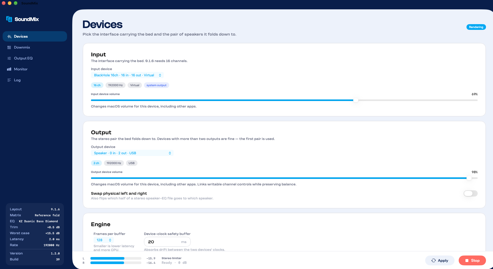
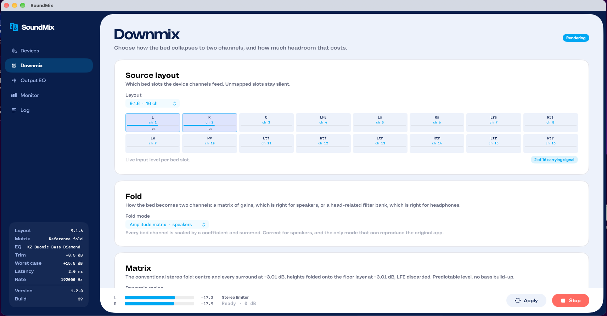
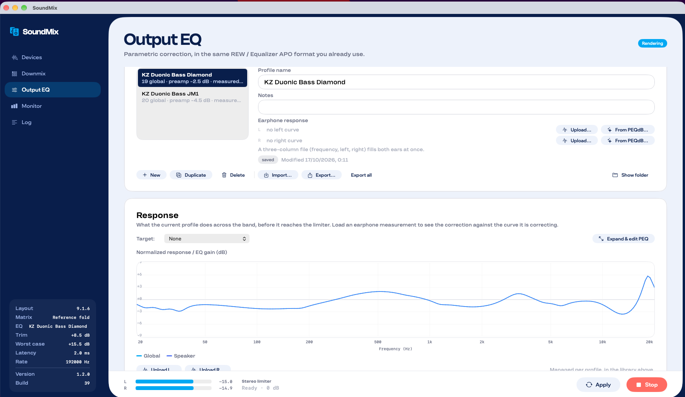
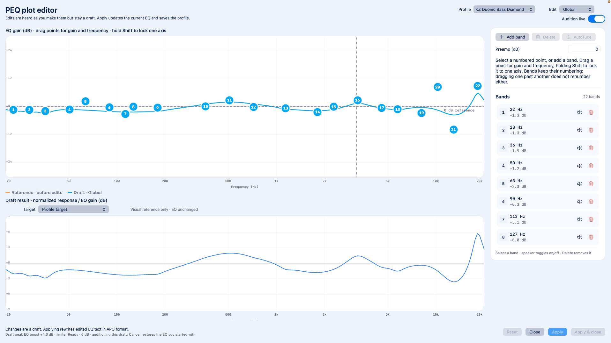
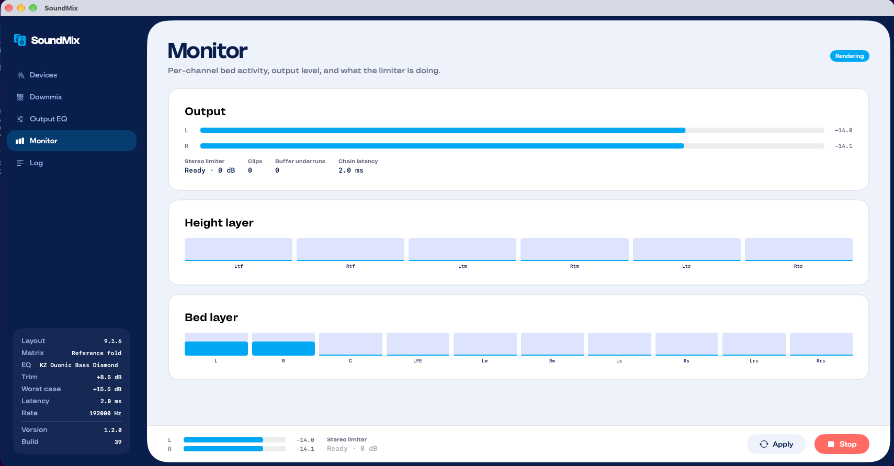

# SoundMix

A native macOS application that folds an immersive audio bed (up to 9.1.6) down
to a stereo pair in real time. It features a correct, configurable downmix matrix,
exact headroom maths, a true-peak limiter, and a powerful parametric equalizer
(PEQ) engine with a database of earphone measurements and reference targets.

It is a native, single-process rebuild of
[peqdb/macos (Downmix Renderer)](https://github.com/peqdb/macos), sharing that
project's device setup while adding a full GUI, device volume control, and an
interactive EQ studio.

## Features

- **Downmix matrix** — four selectable recipes for folding the 16-channel bed
  (`L,R,C,LFE,Ls,Rs,Lrs,Rrs,Lw,Rw,Ltf,Rtf,Ltm,Rtm,Ltr,Rtr`) to stereo: **Original
  parity** (the legacy app's matrix, for A/B comparison), **Reference fold**
  (conventional −3 dB fold), **Immersive fold** (depth-weighted, with opposite-side
  bleed so the rear field doesn't collapse), and **Lt/Rt** (matrix-encoded for a
  downstream surround decoder). Every coefficient is visible and data-driven rather
  than compiled in.
- **Headroom and the limiter** — the Downmix panel computes worst-case gain,
  uncorrelated gain, automatic trim and total applied gain live, in dB, before you
  press Start. A 4× oversampled, look-ahead true-peak limiter replaces the
  original's blunt fixed preamp.
- **Binaural / HRTF fold** — an alternative to the amplitude matrix for headphone
  listening: each bed channel is convolved with a synthesised head-related filter
  bank (Woodworth ITD, Brown-Duda head shadow, elevation-dependent pinna notch),
  with no measured dataset to license or download. Runs at ~30× real time at 48 kHz.
- **Device-aware engine** — direct Core Audio (AUHAL) I/O with live device-loss
  notifications, any sample rate the output device runs at, and per-device
  input/output volume control.

### EQ Studio & PEQdB Integration

- **Graphical PEQ editor** — a full-screen, native editor for Global and per-speaker
  (L/R) EQ. Drag bands for gain and frequency, audition edits live against the
  running audio, and Apply to save. Supports REW / Equalizer APO PEQ text import
  and export.
- **PEQdB picker** — search and load measured earphone/headphone curves directly
  from the [PEQdB](https://peqdb.com) database (brand → model → variant) instead of
  hand-editing measurement files; matched L/R pairs fill both ears at once.
- **AutoTune** — a small-scale AutoEq: greedily designs peaking filters that pull a
  measured earphone/headphone response onto a chosen target curve, writing ordinary
  PEQ bands you can then drag and refine by hand.
- **Target curves** — bundled reference targets (Harman IE 2019, IEF Preference,
  PEQdB Diamond β/HiFi/Ultra, Moondrop VDSF, and more) ship with the app for
  AutoTune and preview, with no network connection required.
- **Earphone correction** — each EQ profile can carry a measured response (AutoEQ,
  oratory1990, squig.link or REW export). The Response plot overlays the measured
  curve, the EQ being applied, and the resulting corrected response together.
- **EQ profile library** — save, export and import complete profiles (EQ text,
  measurement, target) as a portable format.

See [`SoundMix/README.md`](SoundMix/README.md) for the full feature writeup,
architecture notes, and a detailed comparison against the original app.

## Screenshots

| Devices | Downmix |
|---|---|
|  |  |

| Output EQ | PEQ editor |
|---|---|
|  |  |



## Requirements

- **macOS 14 or later**, on the architecture you build for (ad-hoc signed local
  builds are not universal).
- **A virtual loopback device** to get decoded, multichannel PCM audio into
  SoundMix — [BlackHole 16ch](https://existential.audio/blackhole/) is the one
  this project and [peqdb/macos](https://github.com/peqdb/macos) are set up for.
  SoundMix does not decode Dolby Atmos or other proprietary bitstreams itself;
  your player (Apple Music, a DAW, …) must output already-decoded PCM to the
  loopback device.
  - In **Audio MIDI Setup**, configure the loopback device's channel layout
    (e.g. 9.1.6) with channels labeled 1–16 in ascending order.
- **Microphone permission** — macOS classes every Core Audio input, including a
  virtual loopback device, as a microphone. SoundMix cannot capture audio
  without it; the first **Start** triggers the system prompt.
- **To build from source**: a Swift 6 toolchain and the macOS SDK only — no
  Xcode project, no package manager, no network access.

## Layout

| Path | What it is |
|---|---|
| [`SoundMix/`](SoundMix/) | The app itself — source, tests, build and packaging scripts. See [`SoundMix/README.md`](SoundMix/README.md) for build instructions, versioning, and architecture notes. |
| `Targets/` | Source reference EQ target curves (Harman, PEQdB, Moondrop VDSF, …), synced into `SoundMix/Resources/Targets` at build time. |

## Quick start

```bash
cd SoundMix
./build.sh              # builds build/SoundMix.app
./run-offline-tests.sh  # DSP + file-render checks, no hardware needed
./build-dmg.sh          # packages dist/SoundMix-<version>-build-<number>.dmg
```

Swift 6 toolchain and the macOS SDK are the only requirements — no Xcode project,
no package manager, no network access required to build.

## Releases

Every verified DMG build is published as a GitHub release with the DMG attached.
This is automated: `SoundMix/build-dmg.sh` tags the release commit, then (with
`UPLOAD_RELEASE=1`) publishes `dist/SoundMix-<version>-build-<number>.dmg` to a
matching GitHub release via `gh`. See
[`RELEASING.md`](RELEASING.md) for the full step-by-step procedure.

## Thanks

- [peqdb/macos](https://github.com/peqdb/macos) — for the original Downmix Renderer
  idea this app rebuilds.
- [PEQdB](https://peqdb.com) — for the earphone/headphone measurement database
  behind the PEQdB picker.

## License

[ISC](LICENSE)
